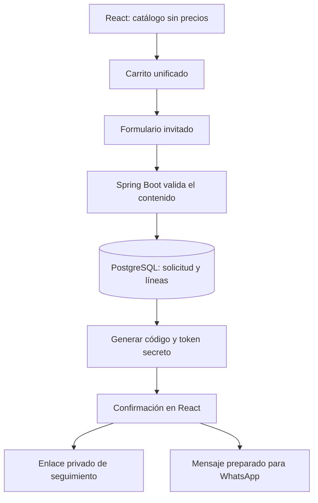

# Arquitectura y secuencia recomendada

## Modularidad

Backend Java monolítico con responsabilidades separadas:

- `catalog` — consultas de productos y servicios activos, sin precios privados.
- `request` — validación, persistencia, detalle y códigos de solicitudes.
- `tracking` — token seguro para consultas limitadas.
- `config` — políticas de seguridad y configuración.
- `common` — manejo centralizado de errores.

Módulos **planeados pero aún no implementados**: clientes registrados, roles administrativos, autorización de visitas, tarifas de diagnóstico, cotizaciones versionadas, inventario, órdenes de trabajo, informes y adjuntos.

### Flujo integrado

## UX aplicada

- Diseño corporativo: fondo claro, botones azul petróleo, toques cobre, tipografía IBM Plex Sans (o fallback legible).
- Divulgación progresiva: revisar → datos → confirmar → resultado.
- Campos condicionales: ubicación solo si se selecciona servicio técnico.
- Acción principal única por tarjeta: **Agregar a mi solicitud**.
- Mensajes explícitos de error y éxito; no atribuir envío automático a WhatsApp.
- Controles y texto accesibles; revisar accesibilidad formal con usuarios reales antes de publicar.

## Acuerdo metodológico

Cascada para entregables del curso (requerimientos → diseño → implementación → pruebas → entrega), con verificación continua por módulo durante la implementación. Las decisiones pendientes se registran, no se inventan.

## Próximos incrementos técnicos (orden sugerido)

1. Validar `vertical 01` con backend y PostgreSQL reales y corregir incidencias.
2. Autenticación y roles: propietario, coordinación, técnico y cliente registrado.
3. Panel interno: ver solicitudes y actualizar estados con trazabilidad.
4. Cotizaciones económicas versionadas con precios solo privados.
5. Visitas de diagnóstico: autorización, precio acordado, comprobantes y programación según política validada.
6. Ordenes de trabajo, evidencias técnicas, informes y seguimiento del cliente.
7. Inventario y ventas transaccionales; respaldos, restauración y pruebas de seguridad.

Los temas comerciales abiertos deben validarse antes de su implementación, especialmente cobro de visitas y gestión de adelantos.
